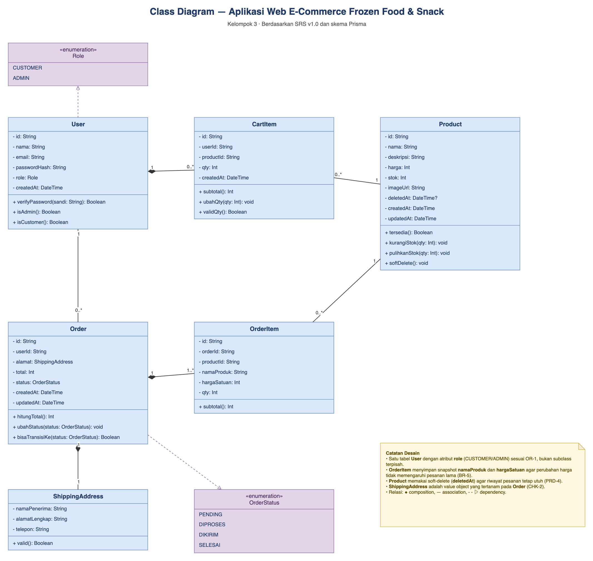
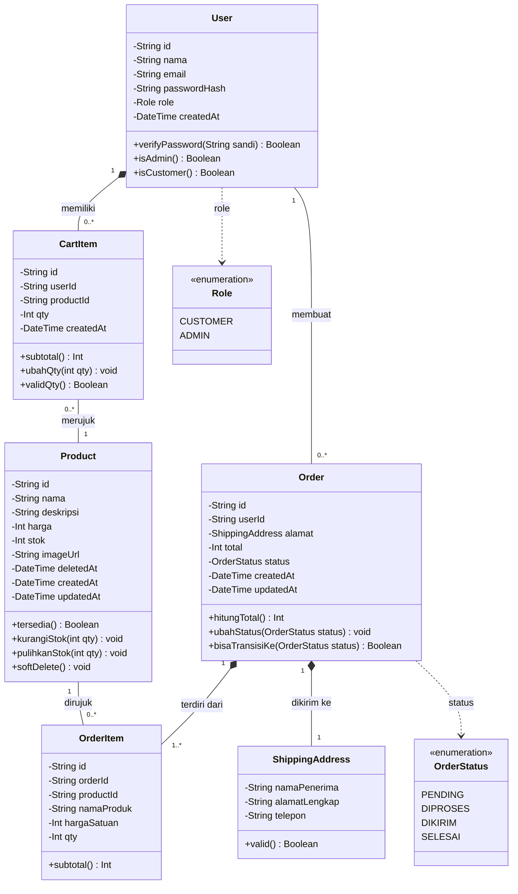

# Class Diagram

## Aplikasi Web E-Commerce Frozen Food & Snack

**File diagram:** [`class-diagram.drawio`](./class-diagram.drawio)
**Pratinjau:** [`class-diagram-preview.png`](./class-diagram-preview.png)
**Acuan:** SRS Aplikasi Web E-Commerce Frozen Food & Snack v1.0 — OR-1, CHK-2, PRD-4, BR-5
**Tech stack acuan:** Next.js (App Router), Prisma ORM, MySQL

Class diagram ini memodelkan **domain/entity classes** yang menjadi dasar skema
Prisma, bukan class UI atau server action Next.js (keduanya berbasis fungsi,
bukan class). Diagram memuat **6 class**, **2 enumeration**, dan **8 relasi**.

---

## 1. Daftar Class

| Class | Peran | Atribut utama | Metode utama |
|---|---|---|---|
| **User** | Akun pelanggan atau admin | `id`, `nama`, `email`, `passwordHash`, `role`, `createdAt` | `verifyPassword()`, `isAdmin()`, `isCustomer()` |
| **Product** | Produk frozen food/snack | `id`, `nama`, `deskripsi`, `harga`, `stok`, `imageUrl`, `deletedAt`, `createdAt`, `updatedAt` | `tersedia()`, `kurangiStok()`, `pulihkanStok()`, `softDelete()` |
| **CartItem** | Satu baris keranjang milik user | `id`, `userId`, `productId`, `qty`, `createdAt` | `subtotal()`, `ubahQty()`, `validQty()` |
| **Order** | Pesanan hasil checkout | `id`, `userId`, `alamat`, `total`, `status`, `createdAt`, `updatedAt` | `hitungTotal()`, `ubahStatus()`, `bisaTransisiKe()` |
| **OrderItem** | Satu baris item pada pesanan | `id`, `orderId`, `productId`, `namaProduk`, `hargaSatuan`, `qty` | `subtotal()` |
| **ShippingAddress** | Value object alamat pengiriman | `namaPenerima`, `alamatLengkap`, `telepon` | `valid()` |

### Enumeration

| Enum | Nilai |
|---|---|
| **Role** | `CUSTOMER`, `ADMIN` |
| **OrderStatus** | `PENDING`, `DIPROSES`, `DIKIRIM`, `SELESAI` |

---

## 2. Relasi

| Sumber | Target | Tipe | Multiplisitas | Keterangan |
|---|---|---|---|---|
| User | CartItem | **Composition** | `1` → `0..*` | Keranjang dimiliki satu user; item keranjang ikut terhapus bersama user. |
| User | Order | Association | `1` → `0..*` | User dapat membuat banyak pesanan; pesanan tetap tersimpan sebagai riwayat. |
| CartItem | Product | Association | `0..*` → `1` | Setiap baris keranjang merujuk tepat satu produk. |
| Product | OrderItem | Association | `1` → `0..*` | Produk dapat muncul pada banyak item pesanan. |
| Order | OrderItem | **Composition** | `1` → `1..*` | Pesanan terdiri atas minimal satu item; item tidak berdiri sendiri. |
| Order | ShippingAddress | **Composition** | `1` → `1` | Alamat pengiriman wajib dan tertanam pada pesanan (CHK-2). |
| User | Role | Dependency | — | Atribut `role` bertipe enumerasi `Role` (AUTH-7, OR-1). |
| Order | OrderStatus | Dependency | — | Atribut `status` bertipe enumerasi `OrderStatus` (BR-2, BR-3). |

---

## 3. Catatan Desain

- **Satu tabel `User`, bukan subclass `Customer`/`Admin`.** Sesuai OR-1, peran
  dibedakan lewat atribut `role` bertipe enum `Role`. Ini juga memetakan
  langsung ke model Prisma (`enum Role { CUSTOMER ADMIN }`).
- **`ShippingAddress` adalah value object.** Di Prisma, field `namaPenerima`,
  `alamatLengkap`, dan `telepon` dapat ditanam langsung pada `Order`; class ini
  dipakai untuk menunjukkan bahwa ketiganya adalah satu kesatuan nilai.
- **`OrderItem` menyimpan snapshot.** `namaProduk` dan `hargaSatuan` disalin
  saat checkout sehingga perubahan harga produk tidak mengubah pesanan lama
  (BR-5, CHK-3).
- **`Product` memakai soft-delete.** `deletedAt` menandai produk terhapus tanpa
  menghapus barisnya, sehingga `OrderItem` lama tetap valid (PRD-4).
- **Tidak ada class `Cart` terpisah.** Sesuai OR-1, keranjang direpresentasikan
  langsung oleh kumpulan `CartItem` milik `User`; total keranjang dihitung dari
  `subtotal()` setiap item.
- **`Order.total` disimpan.** Nilai ini adalah hasil `hitungTotal()` saat
  checkout dan tidak dihitung ulang saat menampilkan riwayat (CHK-5).
- **Metode `ubahStatus()` memakai aturan transisi satu arah**
  `PENDING → DIPROSES → DIKIRIM → SELESAI`; `bisaTransisiKe()` menjadi
  guard-nya (TRX-3, TRX-4, BR-3).

---

## 4. Sumber Mermaid

Diagram yang sama dalam sintaks Mermaid (dirender otomatis oleh GitHub):

---

## 5. Cara Membuka dan Mengedit

1. Buka [draw.io](https://app.diagrams.net) atau draw.io Desktop.
2. Pilih **File → Open From → Device**, lalu pilih `class-diagram.drawio`.
3. Seluruh class, atribut, metode, enumeration, dan garis relasi adalah objek
   native draw.io yang dapat dipindah dan diedit.
4. Untuk laporan: **File → Export as → PNG/SVG/PDF**.
5. Jika mengubah diagram, perbarui juga blok Mermaid pada README ini agar
   keduanya tetap konsisten.
