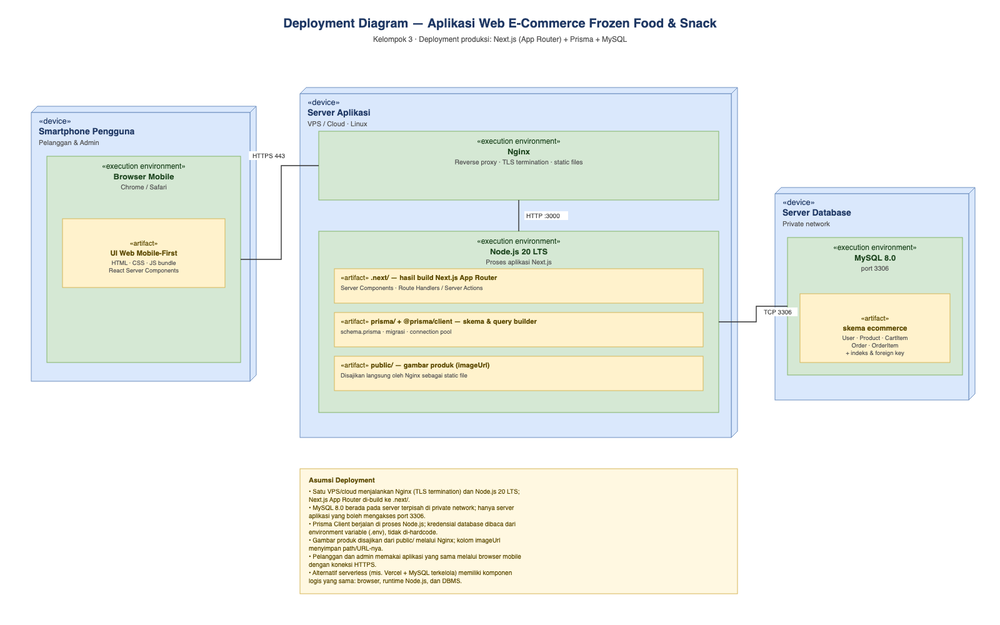
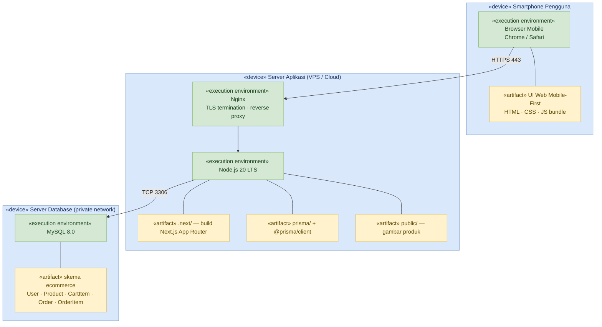

# Deployment Diagram

## Aplikasi Web E-Commerce Frozen Food & Snack

**File diagram:** [`deployment-diagram.drawio`](./deployment-diagram.drawio)
**Pratinjau:** [`deployment-diagram-preview.png`](./deployment-diagram-preview.png)
**Acuan:** [`../diagram-class/class-diagram.drawio`](../diagram-class/class-diagram.drawio), [`../diagram-object/object-diagram.drawio`](../diagram-object/object-diagram.drawio), dan AGENT.md (tech stack)
**Tech stack:** Next.js (App Router), Tailwind CSS, Prisma ORM, MySQL 8.0

Deployment diagram ini memodelkan **lingkungan produksi** aplikasi: node
perangkat pengguna, server aplikasi, dan server database, beserta artifact yang
di-deploy dan jalur komunikasinya. Diagram memuat **3 node «device»**,
**4 execution environment**, **5 artifact**, dan **3 communication path**.

---

## 1. Daftar Node

| Node | Stereotip | Isi | Keterangan |
|---|---|---|---|
| **Smartphone Pengguna** | `«device»` | Browser Mobile | Perangkat pelanggan maupun admin; aplikasi diakses lewat browser (mobile-first) |
| **Server Aplikasi** | `«device»` | Nginx, Node.js 20 LTS | VPS/cloud Linux yang menjalankan reverse proxy dan proses Next.js |
| **Server Database** | `«device»` | MySQL 8.0 | Server terpisah di private network |

### Execution Environment

| Environment | Node induk | Peran |
|---|---|---|
| **Browser Mobile** (Chrome/Safari) | Smartphone Pengguna | Menjalankan UI web mobile-first (React Server Components + JS bundle) |
| **Nginx** | Server Aplikasi | TLS termination, reverse proxy ke Node.js, menyajikan file statis |
| **Node.js 20 LTS** | Server Aplikasi | Menjalankan Next.js App Router, Server Actions/Route Handlers, dan Prisma Client |
| **MySQL 8.0** | Server Database | DBMS yang menyimpan skema `ecommerce` |

### Artifact

| Artifact | Di-deploy pada | Isi |
|---|---|---|
| **UI Web Mobile-First** | Browser Mobile | HTML, CSS, dan JS bundle hasil render Next.js |
| **`.next/`** | Node.js | Hasil build Next.js App Router: Server Components, Route Handlers/Server Actions |
| **`prisma/` + `@prisma/client`** | Node.js | `schema.prisma`, migrasi, dan query builder/connection pool |
| **`public/`** | Node.js + Nginx | Gambar produk yang dirujuk kolom `imageUrl`; disajikan sebagai static file |
| **Skema `ecommerce`** | MySQL | Tabel `User`, `Product`, `CartItem`, `Order`, `OrderItem`, indeks, dan foreign key |

---

## 2. Communication Path

| Sumber | Target | Protokol | Keterangan |
|---|---|---|---|
| Browser Mobile | Nginx | **HTTPS 443** | Seluruh trafik pengguna dienkripsi TLS; hanya port 443 yang terbuka ke publik |
| Nginx | Node.js | **HTTP :3000** | `proxy_pass` ke proses Next.js di localhost; tidak diekspos ke internet |
| Node.js (Prisma Client) | MySQL 8.0 | **TCP 3306** | Koneksi database melalui private network dengan kredensial dari `.env` |

---

## 3. Alur Request Produksi

1. Pengguna membuka aplikasi di browser mobile melalui `https://<domain>`.
2. Nginx menerima koneksi TLS, lalu meneruskan request ke proses Next.js di
   `127.0.0.1:3000`.
3. Next.js memproses halaman/Server Action. Untuk data, Prisma Client mengirim
   query ke MySQL melalui TCP 3306.
4. MySQL mengembalikan hasil query; Next.js merender response dan mengirimkannya
   kembali ke browser melalui Nginx.
5. Permintaan file statis (`/_next/static`, gambar di `public/`) dilayani
   langsung oleh Nginx tanpa melewati Node.js.

---

## 4. Asumsi dan Catatan Desain

- **Deployment bersifat platform-neutral.** Diagram memakai satu VPS/cloud
  Linux sebagai baseline. Alternatif serverless (misalnya Vercel + MySQL
  terkelola) memiliki komponen logis yang sama: browser, runtime Node.js, dan
  DBMS.
- **Server database terpisah.** MySQL tidak dijalankan di container yang sama
  dengan aplikasi; akses dibatasi pada private network dan hanya dari server
  aplikasi (least privilege).
- **TLS berakhir di Nginx.** Node.js tidak menangani sertifikat; komunikasi
  internal Nginx → Node.js memakai HTTP di localhost.
- **Kredensial tidak di-hardcode.** `DATABASE_URL` dan secret lain dibaca dari
  environment variable (`.env`) sesuai praktik keamanan SRS (SEC-1, SEC-4).
- **Prisma Client berjalan di proses Node.js**, bukan service terpisah. Karena
  itu `prisma/` dan `@prisma/client` digambar sebagai artifact di dalam
  execution environment Node.js.
- **Gambar produk** disimpan di `public/` dan disajikan Nginx; `imageUrl` pada
  tabel `Product` menyimpan path atau URL gambar.
- **Admin dan pelanggan memakai deployment yang sama.** Pembedaan hak akses
  dilakukan di server berdasarkan `User.role` (`CUSTOMER`/`ADMIN`), bukan
  dengan server terpisah.
- **Tidak ada node CDN, queue, atau payment gateway** karena tidak termasuk
  lingkup SRS v1.0 dan tech stack proyek.

---

## 5. Sumber Mermaid

Mermaid belum memiliki tipe diagram *deployment* bawaan, sehingga struktur yang
sama direpresentasikan sebagai flowchart dengan subgraph (dirender otomatis
oleh GitHub).

---

## 6. Cara Membuka dan Mengedit

1. Buka [draw.io](https://app.diagrams.net) atau draw.io Desktop.
2. Pilih **File → Open From → Device**, lalu pilih `deployment-diagram.drawio`.
3. Seluruh node, execution environment, artifact, koneksi, dan catatan adalah
   objek native draw.io yang dapat dipindah dan diedit.
4. Untuk laporan: **File → Export as → PNG/SVG/PDF**.
5. Jika mengubah diagram, perbarui juga tabel node, tabel communication path,
   pratinjau, dan blok Mermaid pada README ini agar tetap konsisten.
