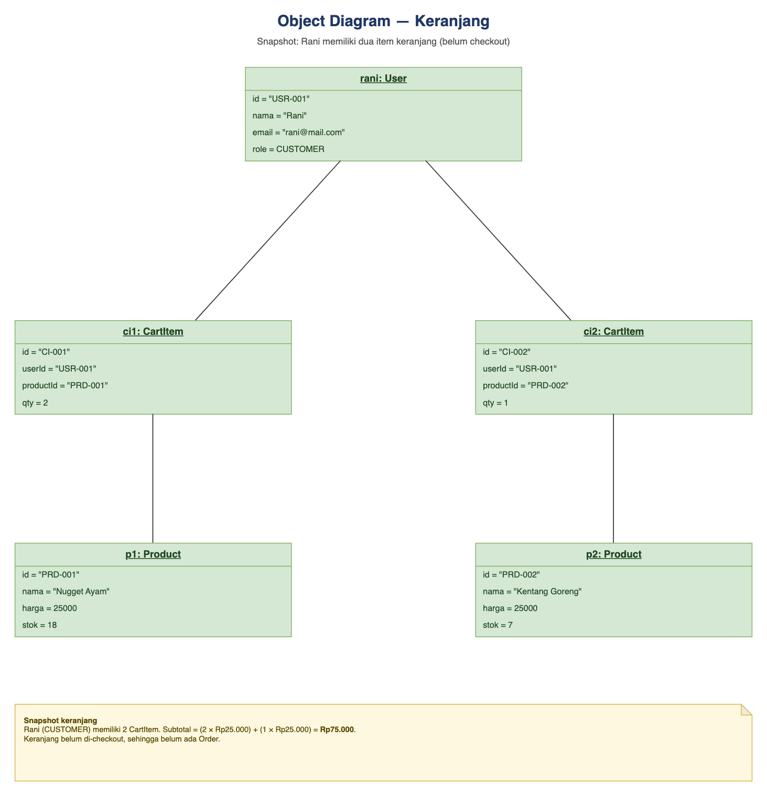
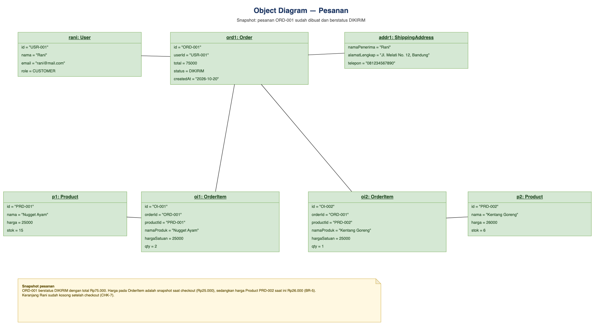
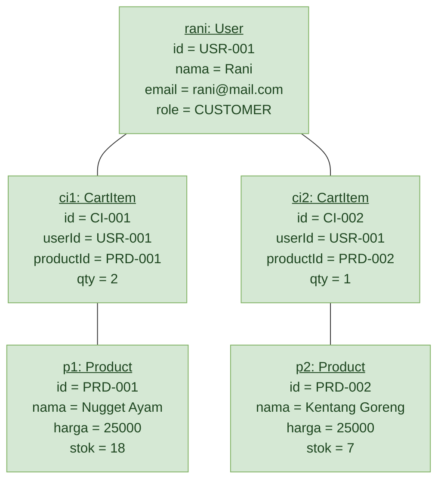
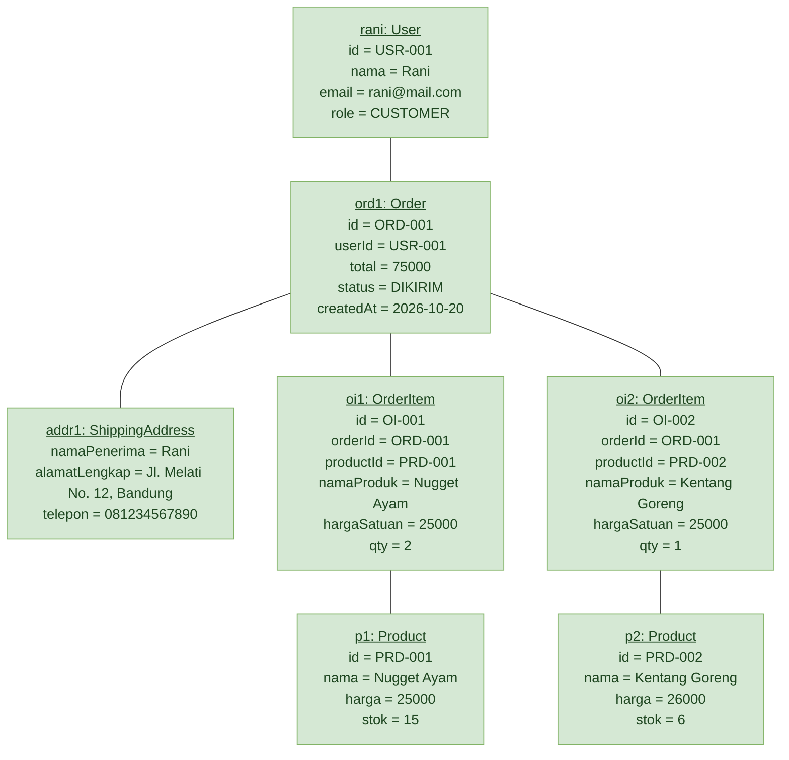

# Object Diagram

## Aplikasi Web E-Commerce Frozen Food & Snack

**File diagram:** [`object-diagram.drawio`](./object-diagram.drawio)

**Pratinjau:**

| OD-1 Keranjang | OD-2 Pesanan |
|---|---|
|  |  |

**Acuan:** [`../diagram-class/class-diagram.drawio`](../diagram-class/class-diagram.drawio) dan SRS Aplikasi Web E-Commerce Frozen Food & Snack v1.0 (CHK-3, CHK-7, BR-3, BR-5, PRD-4)
**Tech stack acuan:** Next.js (App Router), Prisma ORM, MySQL

Object diagram ini menampilkan **dua snapshot instance** dari class diagram pada
titik waktu yang berbeda. Total ada **9 objek unik**, **6 class domain**, dan
**10 link**:

| Snapshot | Objek | Fokus |
|---|---|---|
| **OD-1 Keranjang** | `rani: User`, `ci1`/`ci2: CartItem`, `p1`/`p2: Product` | Keadaan sebelum checkout; subtotal Rp75.000 |
| **OD-2 Pesanan** | `rani: User`, `ord1: Order`, `addr1: ShippingAddress`, `oi1`/`oi2: OrderItem`, `p1`/`p2: Product` | Pesanan `ORD-001` berstatus `DIKIRIM`; total Rp75.000 |

Kedua snapshot memakai objek `rani`, `p1`, dan `p2` yang sama sehingga
perubahan state (harga dan stok) dapat dibandingkan langsung.

---

## 1. OD-1 — Keranjang (sebelum checkout)

### Objek

| Objek | Class | Nilai atribut |
|---|---|---|
| **rani** | `User` | `id = "USR-001"`, `nama = "Rani"`, `email = "rani@mail.com"`, `role = CUSTOMER` |
| **ci1** | `CartItem` | `id = "CI-001"`, `userId = "USR-001"`, `productId = "PRD-001"`, `qty = 2` |
| **ci2** | `CartItem` | `id = "CI-002"`, `userId = "USR-001"`, `productId = "PRD-002"`, `qty = 1` |
| **p1** | `Product` | `id = "PRD-001"`, `nama = "Nugget Ayam"`, `harga = 25000`, `stok = 18` |
| **p2** | `Product` | `id = "PRD-002"`, `nama = "Kentang Goreng"`, `harga = 25000`, `stok = 7` |

### Link

| Sumber | Target | Padanan class diagram |
|---|---|---|
| rani | ci1 | User `1` ◆ `0..*` CartItem |
| rani | ci2 | User `1` ◆ `0..*` CartItem |
| ci1 | p1 | CartItem `0..*` — `1` Product |
| ci2 | p2 | CartItem `0..*` — `1` Product |

**Perhitungan subtotal:** `(2 × Rp25.000) + (1 × Rp25.000) = Rp75.000.`
Belum ada objek `Order` karena keranjang belum di-checkout.

---

## 2. OD-2 — Pesanan (setelah checkout)

### Objek

| Objek | Class | Nilai atribut |
|---|---|---|
| **rani** | `User` | `id = "USR-001"`, `nama = "Rani"`, `email = "rani@mail.com"`, `role = CUSTOMER` |
| **ord1** | `Order` | `id = "ORD-001"`, `userId = "USR-001"`, `total = 75000`, `status = DIKIRIM`, `createdAt = "2026-10-20"` |
| **addr1** | `ShippingAddress` | `namaPenerima = "Rani"`, `alamatLengkap = "Jl. Melati No. 12, Bandung"`, `telepon = "081234567890"` |
| **oi1** | `OrderItem` | `id = "OI-001"`, `orderId = "ORD-001"`, `productId = "PRD-001"`, `namaProduk = "Nugget Ayam"`, `hargaSatuan = 25000`, `qty = 2` |
| **oi2** | `OrderItem` | `id = "OI-002"`, `orderId = "ORD-001"`, `productId = "PRD-002"`, `namaProduk = "Kentang Goreng"`, `hargaSatuan = 25000`, `qty = 1` |
| **p1** | `Product` | `id = "PRD-001"`, `nama = "Nugget Ayam"`, `harga = 25000`, `stok = 15` |
| **p2** | `Product` | `id = "PRD-002"`, `nama = "Kentang Goreng"`, `harga = 26000`, `stok = 6` |

### Link

| Sumber | Target | Padanan class diagram |
|---|---|---|
| rani | ord1 | User `1` — `0..*` Order |
| ord1 | addr1 | Order `1` ◆ `1` ShippingAddress |
| ord1 | oi1 | Order `1` ◆ `1..*` OrderItem |
| ord1 | oi2 | Order `1` ◆ `1..*` OrderItem |
| oi1 | p1 | Product `1` — `0..*` OrderItem |
| oi2 | p2 | Product `1` — `0..*` OrderItem |

---

## 3. Konsistensi ID

| Relasi | Nilai yang harus cocok | Terpenuhi |
|---|---|---|
| `CartItem.userId` → `User.id` | `USR-001` | ✅ |
| `CartItem.productId` → `Product.id` | `PRD-001`, `PRD-002` | ✅ |
| `Order.userId` → `User.id` | `USR-001` | ✅ |
| `OrderItem.orderId` → `Order.id` | `ORD-001` | ✅ |
| `OrderItem.productId` → `Product.id` | `PRD-001`, `PRD-002` | ✅ |

---

## 4. Catatan Desain

- **Object diagram adalah snapshot, bukan model lengkap.** Satu objek mewakili
  satu baris data pada satu waktu; class diagram tetap menjadi acuan struktur.
  Karena itu tidak semua instance yang mungkin (misalnya admin atau pesanan
  lain) digambar.
- **Dua snapshot dipakai untuk menunjukkan perubahan state.** OD-1 menangkap
  keranjang sebelum checkout, OD-2 menangkap pesanan setelah checkout.
- **Harga item pesanan adalah snapshot (BR-5, CHK-3).** `oi2.hargaSatuan =
  25000` sengaja berbeda dari `p2.harga = 26000` pada OD-2. Perubahan harga
  produk setelah checkout tidak boleh mengubah `ord1.total`.
- **Keranjang kosong setelah checkout (CHK-7).** OD-2 tidak memuat `CartItem`,
  sesuai aturan bahwa checkout mengosongkan keranjang pengguna.
- **Stok berkurang karena pembelian.** `p1.stok` turun dari 18 menjadi 15 dan
  `p2.stok` turun dari 7 menjadi 6, konsisten dengan qty 2 dan 1 (CHK-6).
- **`addr1` adalah value object.** `ShippingAddress` tidak punya tabel sendiri;
  objek ini digambar terpisah untuk menegaskan bahwa ketiga atributnya adalah
  satu kesatuan nilai milik `ord1`.
- **Status `DIKIRIM` mengikuti transisi satu arah** `PENDING → DIPROSES →
  DIKIRIM → SELESAI` (BR-2, BR-3, TRX-3).
- **Nama objek digaris bawah** dengan format `namaObjek: NamaClass` sesuai
  notasi UML. Tidak ada compartment metode karena object diagram hanya
  menampilkan state.
- **Link digambar sebagai garis asosiasi.** Multiplisitas dan jenis relasi
  (association/composition) dijelaskan pada tabel dan mengikuti class diagram.

---

## 5. Sumber Mermaid

Mermaid belum memiliki tipe diagram *object* bawaan, sehingga kedua snapshot
direpresentasikan sebagai flowchart (dirender otomatis oleh GitHub).

### OD-1 Keranjang

### OD-2 Pesanan

---

## 6. Cara Membuka dan Mengedit

1. Buka [draw.io](https://app.diagrams.net) atau draw.io Desktop.
2. Pilih **File → Open From → Device**, lalu pilih `object-diagram.drawio`.
3. File berisi **dua halaman** (tab di bawah kanvas): **OD-1 Keranjang** dan
   **OD-2 Pesanan**. Seluruh objek, nilai atribut, link, dan catatan adalah
   objek native draw.io yang dapat dipindah dan diedit.
4. Untuk laporan: **File → Export as → PNG/SVG/PDF** (pilih *All Pages* jika
   ingin mengekspor kedua snapshot sekaligus).
5. Jika mengubah diagram, perbarui juga tabel objek, tabel link, pratinjau, dan
   blok Mermaid pada README ini agar tetap konsisten.
