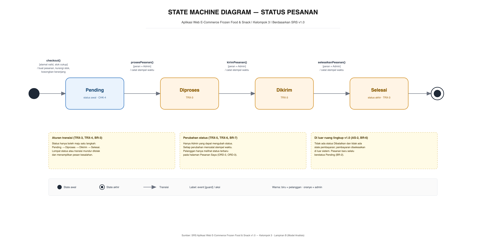

# State Machine Diagram

## Aplikasi Web E-Commerce Frozen Food & Snack

**File diagram:** [`state-machine-diagram.drawio`](./state-machine-diagram.drawio)  
**Pratinjau PNG:**

1. [Status Pesanan](./01-status-pesanan.png) — diagram utama
2. [Status Keranjang](./02-status-keranjang.png)
3. [Status Produk](./03-status-produk.png)
4. [Sesi Pengguna](./04-sesi-pengguna.png)



Diagram ini disusun berdasarkan **SRS Aplikasi Web E-Commerce Frozen Food & Snack v1.0**, terutama Lampiran B (Model Analisis) yang secara eksplisit meminta **Diagram State Status Pesanan**: state `Pending → Diproses → Dikirim → Selesai` beserta transisi yang diizinkan.

File draw.io memuat **4 halaman**:

| Halaman | Nama | Fokus |
|---|---|---|
| 1 | **Status Pesanan** | Siklus hidup pesanan, dari checkout sampai selesai. Ini diagram utama yang diminta SRS. |
| 2 | **Status Keranjang** | Perpindahan `Kosong → Berisi → Checkout` dan kembali ke keranjang/kosong. |
| 3 | **Status Produk** | Ketersediaan produk berdasarkan stok (`Tersedia` dan `Habis`). |
| 4 | **Sesi Pengguna** | Perpindahan status `Tamu` dan `Terautentikasi` saat login/logout. |

---

## 1. Mengapa Hanya Empat Diagram?

State machine diagram **bukan** diagram yang dibuat untuk setiap use case. Use case menjawab **“siapa melakukan apa”**, sedangkan state machine menjawab **“bagaimana sebuah objek berubah status dari waktu ke waktu”**. Karena itu, yang dimodelkan hanya objek yang benar-benar memiliki siklus status bermakna:

| Objek | Punya siklus status? | Keputusan |
|---|---|---|
| **Pesanan** | Ya: `Pending → Diproses → Dikirim → Selesai`. | Dimodelkan (wajib menurut SRS Lampiran B). |
| **Keranjang** | Ya: `Kosong → Berisi → Checkout`, lalu kembali kosong/berisi. | Dimodelkan. |
| **Produk** | Ya: `Tersedia` dan `Habis` berdasarkan stok. | Dimodelkan. |
| **Sesi pengguna** | Ya: `Tamu` dan `Terautentikasi`. | Dimodelkan. |
| Pembayaran | Tidak dimodelkan di sistem; COD/transfer manual. | Tidak dibuat (AS-2, BR-6). |
| Pengiriman | Tidak ada entitas/status pengiriman terpisah; hanya status pesanan `Dikirim`. | Tidak dibuat. |
| Item pesanan | Snapshot harga dan jumlah; tidak berubah setelah dibuat. | Tidak dibuat. |
| Akun pengguna | Tidak ada status nonaktif/suspend/verifikasi di SRS v1.0. | Tidak dibuat. |

Jadi empat diagram ini sudah mencakup seluruh **objek stateful** yang benar-benar diatur SRS, tanpa mengarang state yang tidak ada kebutuhannya.

Penempatan folder dibuat sejajar dengan diagram lain agar struktur repositori konsisten:

```text
Kelompok_3/
├── srs/
├── diagram-usecase/
├── diagram-sequence/
└── state-machine-diagram/   ← folder ini
```

---

## 2. Halaman 1 — Status Pesanan (Diagram Utama)

### 2.1 State

| State | Makna | Rujukan |
|---|---|---|
| **Pending** | Pesanan baru dibuat setelah checkout dan menunggu diproses admin. | CHK-4, BR-2 |
| **Diproses** | Toko sedang menyiapkan pesanan. | TRX-3 |
| **Dikirim** | Pesanan telah diserahkan ke pengiriman. | TRX-3 |
| **Selesai** | Pesanan telah diterima/dinyatakan tuntas. | TRX-3 |

State awal ditandai lingkaran hitam penuh; state akhir ditandai lingkaran ganda.

### 2.2 Transisi

| No | Dari → Ke | Event | Guard | Aksi | Rujukan |
|---|---|---|---|---|---|
| 1 | State awal → **Pending** | `checkout()` | alamat valid dan stok mencukupi | buat pesanan, kurangi stok, kosongkan keranjang | CHK-2, CHK-3, CHK-4, CHK-6, CHK-7 |
| 2 | **Pending → Diproses** | `prosesPesanan()` | peran = Admin | catat stempel waktu | TRX-3, TRX-5 |
| 3 | **Diproses → Dikirim** | `kirimPesanan()` | peran = Admin | catat stempel waktu | TRX-3, TRX-5 |
| 4 | **Dikirim → Selesai** | `selesaikanPesanan()` | peran = Admin | catat stempel waktu | TRX-3, TRX-5 |
| 5 | **Selesai → State akhir** | completion | — | — | TRX-3 |

### 2.3 Aturan yang Ditegakkan

- Status **hanya boleh maju satu langkah**. Lompat status (misalnya `Pending → Selesai`) atau transisi mundur ditolak dan menampilkan pesan kesalahan (TRX-4, BR-3).
- Hanya **Admin** yang dapat mengubah status (TRX-6, BR-7).
- Setiap perubahan status mencatat **stempel waktu** (TRX-5).
- Pesanan baru **selalu** berstatus `Pending` (BR-2).
- Pada v1.0 **tidak ada status Dibatalkan** dan **tidak ada state pembayaran**, karena pembayaran ditangani di luar sistem (AS-2, BR-6).

---

## 3. Halaman 2 — Status Keranjang

Halaman ini memodelkan keranjang sebagai objek persisten milik pelanggan.

### 3.1 State

| State | Makna | Rujukan |
|---|---|---|
| **Kosong** | Tidak ada item di keranjang. | CART-7 |
| **Berisi** | Ada satu atau lebih item; subtotal dan total dihitung. | CART-6 |
| **Checkout** | Ringkasan pesanan dan formulir alamat sedang ditampilkan; state sementara sebelum pesanan dibuat. | CHK-1, CHK-2 |

### 3.2 Transisi

| Dari → Ke | Event | Guard | Aksi | Rujukan |
|---|---|---|---|---|
| State awal → **Kosong** | login / muat keranjang | belum ada item | muat keranjang dari basis data | CART-7 |
| **Kosong → Berisi** | `tambahProduk()` | stok > 0 | tambah item, hitung total | CART-1, CART-2, CART-5, CART-6 |
| **Berisi → Berisi** | `tambahProduk()`, `ubahJumlah()` | jumlah ≤ stok | hitung ulang total | CART-2, CART-3, CART-5, CART-6 |
| **Berisi → Kosong** | `hapusItem()` | item terakhir | kosongkan keranjang | CART-4 (lihat TBD-3) |
| **Berisi → Checkout** | `checkout()` | login dan keranjang tidak kosong | tampilkan ringkasan + formulir alamat | CHK-1, CHK-2 |
| **Checkout → Kosong** | checkout berhasil | alamat valid dan stok cukup | buat pesanan, kurangi stok, kosongkan keranjang | CHK-3 s.d. CHK-7 |
| **Checkout → Berisi** | checkout gagal | alamat tidak valid atau stok kurang | tampilkan error, tidak ada pesanan parsial | CHK-2, CHK-6 |

Catatan:

- Keranjang disimpan per akun (CART-7). Saat login dengan item tersimpan, state langsung `Berisi`; diagram memulai dari `Kosong` untuk penggunaan pertama.
- Jika jumlah dikurangi di bawah 1, apakah item otomatis dihapus atau pengurangan diblokir masih **TBD-3**.
- Tidak ada state akhir: keranjang adalah wadah persisten. Checkout berhasil mengosongkannya, bukan menghapus objek keranjang.

---

## 4. Halaman 3 — Status Produk

Halaman ini memodelkan **ketersediaan stok**, bukan tampilan katalog.

### 4.1 State

| State | Makna | Rujukan |
|---|---|---|
| **Tersedia** | Stok > 0 sehingga produk dapat dipesan. | CAT-1, PRD-1 |
| **Habis** | Stok = 0 sehingga produk tidak dapat dipesan. | CAT-1, CHK-6 |

### 4.2 Transisi

| Dari → Ke | Event | Guard | Aksi |
|---|---|---|---|
| **Tersedia → Habis** | `stokBerkurang()` | stok = 0 | tandai habis |
| **Habis → Tersedia** | `stokBertambah()` | stok > 0 | tandai tersedia |

Catatan:

- Stok berkurang saat checkout berhasil (CHK-6) dan dapat diubah admin kapan saja (PRD-3).
- Apakah produk habis disembunyikan atau ditampilkan nonaktif masih **TBD-1**.
- Kebijakan **soft-delete vs blokir penghapusan** masih **TBD-5**, sehingga state `Dihapus` belum dimodelkan.
- Tidak ada state akhir karena record produk tetap tersimpan selama belum dihapus.

---

## 5. Halaman 4 — Sesi Pengguna

### 5.1 State

| State | Makna | Rujukan |
|---|---|---|
| **Tamu** | Pengguna belum terautentikasi. Katalog tetap dapat diakses. | CAT-5 |
| **Terautentikasi** | Sesi aktif dengan peran `CUSTOMER` atau `ADMIN`. | AUTH-5, AUTH-7 |

### 5.2 Transisi

| Dari → Ke | Event | Guard | Aksi |
|---|---|---|---|
| State awal → **Tamu** | aplikasi dibuka | — | — |
| **Tamu → Terautentikasi** | `login()` | kredensial valid | buat sesi |
| **Tamu → Tamu** | `login()` | kredensial salah | tampilkan pesan kesalahan |
| **Terautentikasi → Tamu** | `logout()`, `sesiKedaluwarsa()` | — | hapus sesi |

Catatan:

- Peran (`CUSTOMER` / `ADMIN`) disimpan pada sesi dan menentukan halaman tujuan setelah login (AUTH-7).
- Pengguna `Tamu` yang membuka halaman terproteksi diarahkan ke login (AUTH-8).
- Sesi bertahan sampai logout atau kedaluwarsa; cookie sesi bersifat HTTP-only dan Secure saat HTTPS (AUTH-6, SEC-4).
- Registrasi akun tidak mengubah state sesi secara langsung: setelah registrasi berhasil, pengguna diarahkan ke halaman login.
- Akun admin dibuat melalui seeding/migrasi, bukan formulir registrasi publik (AUTH-10).

---

## 6. Notasi

| Simbol | Arti |
|---|---|
| **Lingkaran hitam penuh** | State awal (*initial pseudostate*). |
| **Lingkaran ganda** | State akhir (*final state*). |
| **Kotak bersudut tumpul** | State, yaitu kondisi objek pada suatu waktu. |
| **Panah solid** | Transisi dari satu state ke state lain. |
| **`event [guard] / aksi`** | Format label transisi: kejadian pemicu, syarat yang harus benar, dan aksi yang dijalankan. |
| **Kotak kuning putus-putus** | Catatan penjelas atau aturan bisnis, bukan state. |

Warna pada diagram:

- **Biru** = state yang berkaitan dengan pelanggan (`Pending`, `Berisi`, `Tersedia`).
- **Biru tua** = state `Checkout` yang sedang berlangsung.
- **Oranye** = state yang dikelola admin (`Diproses`, `Dikirim`, `Selesai`).
- **Hijau** = state sesi terautentikasi.
- **Merah** = state produk habis.
- **Abu-abu** = state kosong/tamu.

---

## 7. Catatan Perancangan

- **Fokus utama ada di status pesanan.** Ini adalah satu-satunya state machine yang secara eksplisit diminta SRS Lampiran B; tiga halaman lain disertakan sebagai pelengkap agar perubahan status objek lain tidak ambigu.
- **Tidak ada state pembayaran.** Pembayaran COD/transfer manual diselesaikan di luar sistem (AS-2, BR-6), sehingga state machine pesanan hanya memodelkan pemenuhan pesanan.
- **Tidak ada transisi mundur pada pesanan.** Aturan bisnis BR-3 menegaskan alur satu arah. Transisi yang tidak valid tidak digambar sebagai panah, tetapi dijelaskan pada catatan “Aturan transisi”.
- **State akhir pesanan bukan berarti data dihapus.** State akhir hanya menandakan selesainya siklus hidup pesanan; record pesanan tetap tersimpan untuk riwayat pelanggan dan laporan admin.
- **Keranjang tidak memiliki state akhir.** Keranjang adalah wadah persisten; checkout berhasil mengosongkannya.
- **Status produk dipisahkan dari status tampilan.** `Tersedia`/`Habis` adalah kondisi stok. Apakah produk habis disembunyikan atau ditampilkan nonaktif masih TBD-1, sehingga tidak dijadikan state.
- **Semua label transisi memakai format `event [guard] / aksi`** agar mudah ditelusuri ke kebutuhan fungsional SRS.

---

## 8. Cara Membuka dan Mengedit

1. Buka [draw.io](https://app.diagrams.net) atau aplikasi draw.io Desktop.
2. Pilih **File → Open From → Device**, lalu pilih `state-machine-diagram.drawio`.
3. Gunakan tab halaman di bagian bawah editor untuk berpindah antara **Status Pesanan**, **Status Keranjang**, **Status Produk**, dan **Sesi Pengguna**.
4. Semua state, panah, label, dan catatan merupakan objek native draw.io yang dapat dipindah, diubah teksnya, dan diedit propertinya.
5. Untuk mengekspor ulang: **File → Export as → PNG**, pilih halaman yang diinginkan, aktifkan *Transparent Background* bila perlu, lalu simpan.

---

## 9. Isi Folder

| File | Keterangan |
|---|---|
| `state-machine-diagram.drawio` | File asli draw.io dengan 4 halaman, dapat diedit langsung. |
| `01-status-pesanan.png` | Diagram utama: siklus status pesanan (4000 × 2000 px). |
| `02-status-keranjang.png` | Diagram pelengkap: siklus keranjang belanja (4000 × 2000 px). |
| `03-status-produk.png` | Diagram pelengkap: ketersediaan produk (4000 × 2000 px). |
| `04-sesi-pengguna.png` | Diagram pelengkap: sesi autentikasi (4000 × 2000 px). |
| `README.md` | Penjelasan ini. |

---

Sumber: **SRS Aplikasi Web E-Commerce Frozen Food & Snack v1.0 — Kelompok 3**  
Achmad Zaky Mulyana (202343501777) · Regi Rianto Suyono (202343501754) · Ganang Ardi Pratama (202343501804)
